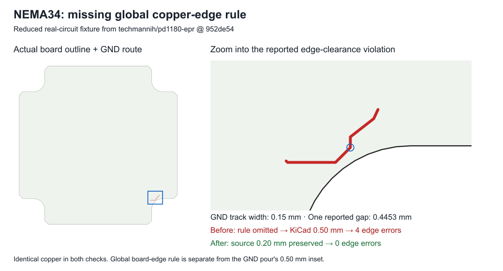

# NEMA34 global copper-edge clearance reproduction



The fixture contains four unchanged records from
[techmannih/pd1180-epr at 952de54](https://github.com/techmannih/pd1180-epr/blob/952de54ca0b5dbe042d9ccc9a1a9ecf3e8f67779/release/circuit.json).
The complete input SHA-256 is
`674a23b77548a731e4e443ed10135bbcd1b8182ef0c262bd4549b1ac5782ffe3`.
Only JSON formatting and removal of unrelated records differ:

- `pcb_board_0`: the real 85.9 mm, four-layer outline and explicit
  `min_board_edge_clearance: 0.2`.
- `source_net_53`: GND.
- `source_trace_0`: the GND connectivity identity.
- `pcb_trace_cloud_routed_46`: the actual six-segment route near the edge.

No coordinates, widths or rule values were invented. Dangling-track warnings
are expected because this reduction omits the route's unrelated endpoints.
The image plots the retained geometry; it is not a KiCad GUI screenshot.

The exporter omits `board.design_settings.rules.min_copper_edge_clearance`.
KiCad consequently uses its 0.5 mm default instead of the authored 0.2 mm.
The retained GND track has a reported gap of about 0.4453 mm and fails that
unintended rule. This is separate from the GND pour's 0.5 mm board-edge inset;
this fixture contains no pour.

Run with KiCad 10 on PATH, or set `KICAD_CLI` to its executable:

```sh
bun test tests/project/board-edge-clearance.test.ts
```

The reproduction PR changes no production code. Two `test.failing` assertions
record the missing project setting and the resulting native KiCad errors.
The stacked fix makes both ordinary passing tests. A separate passing control
confirms that omitting the setting really triggers KiCad's 0.5000 mm rule.
KiCad runs in `beforeAll`, outside the expected-failure assertions, so executable
or process failures fail the suite rather than masquerading as the repro.

Both DRC runs use byte-identical PCB geometry and no suppressed categories.
The missing-rule control and actual exported project are saved with their full
reports in `debug-output/nema34-board-edge-clearance/`. On KiCad 10.0.5 the
unfixed actual export has four edge findings; the fixed export has zero.
Other board/export findings are outside this focused reproduction.
